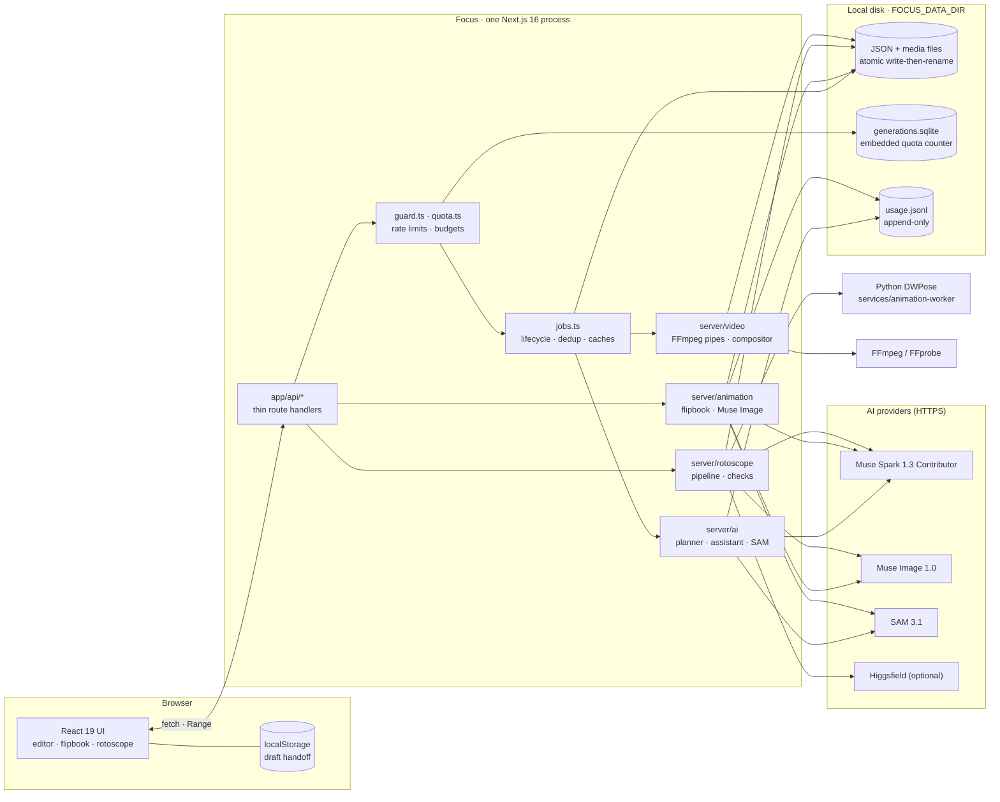
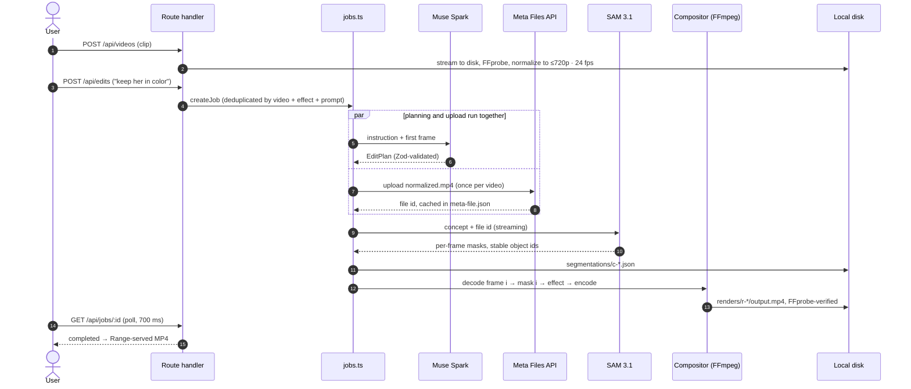
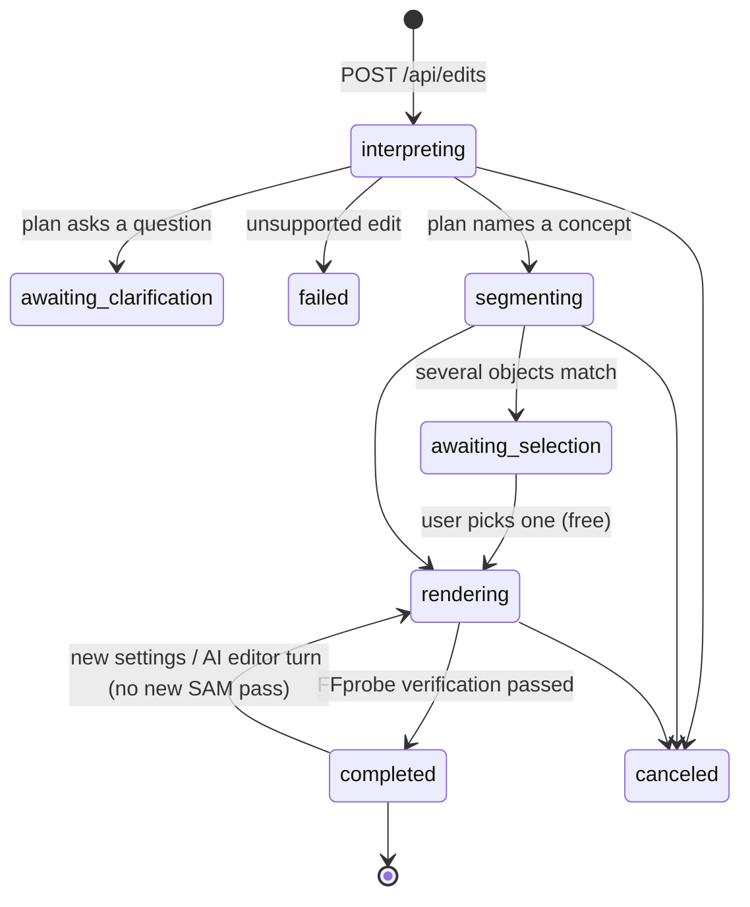
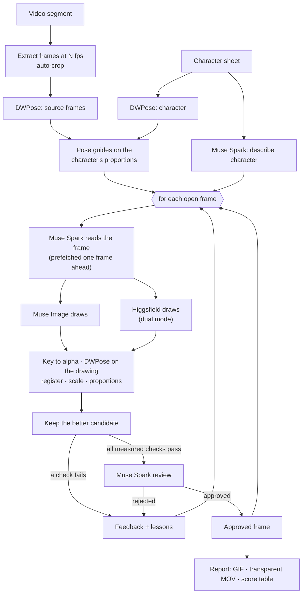
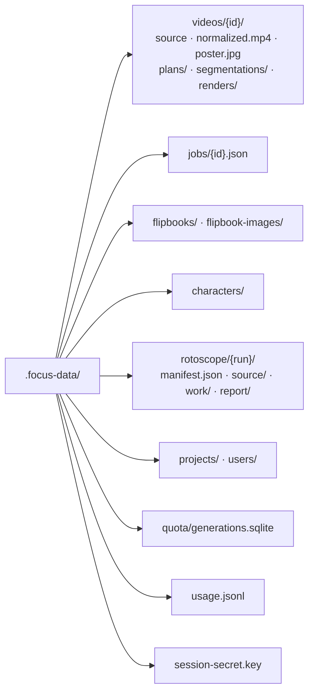
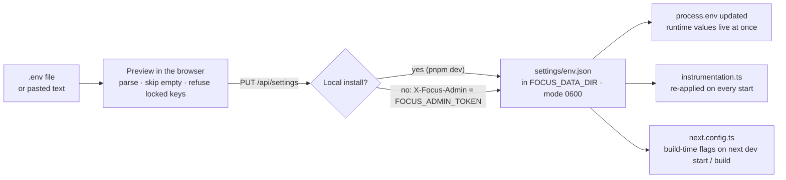
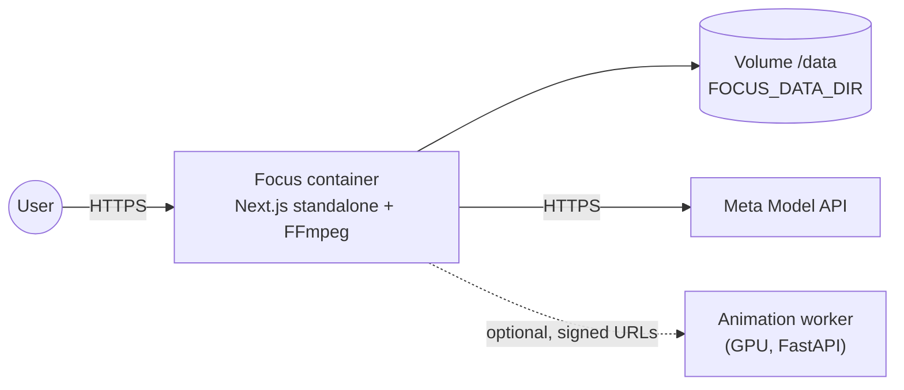

<div align="center">

# Focus

### Make anything stand out.

**An AI video and animation studio that runs on your own machine.**
Describe an edit in one sentence. Focus finds the subject, tracks it frame by frame and renders a cinematic, verified MP4.


[Features](#features) · [Architecture](#architecture) · [Local-first data](#local-first-data) · [Performance](#performance) · [Quick start](#quick-start) · [Configuration](#configuration) · [Testing](#testing) · [Deploy](#deploy)

> Built during the **Meta Global AI Developer Hackathon 2026**. See [the hackathon notes](#built-during-meta-global-ai-developer-hackathon-2026).

</div>

---

## Why Focus

Object-aware video effects (keeping one person in color, letting a dancer step out of the frame, tracing a subject's motion) normally mean rotoscoping by hand, frame by frame, in professional software. Focus turns that workflow into one sentence:

```text
"Keep the white-haired boy in color and turn everything else black and white."
```

Muse Spark reads the instruction and the frame, SAM 3.1 tracks the subject through the clip, and a deterministic compositor renders the result. You get an MP4 that has been checked with FFprobe and is ready to post.

Everything Focus produces stays **on your machine**: uploads, masks, renders, projects, characters and usage logs live in one local folder. Focus needs no database server, no object store and no queue service.

## Features

| Area | What it does | Route |
| --- | --- | --- |
| **Reality Shift** | The subject keeps its color, stays sharp or stands in a spotlight while the rest turns gray, blurs or falls into shadow. | `/editor` |
| **Break the Frame** | The video sits inside an inner frame on a 1080×1350 canvas; the subject steps out across the frame edge. | `/editor` |
| **Motion Echo** | Fading copies of the subject from earlier frames trace its path (static cameras). | `/editor` |
| **Finish** | Color looks (Cinematic, Noir, Golden hour, Moonlight, Vintage film, Vivid), glow or outline from the subject's own mask, vignette, grain, letterbox. | `/editor` |
| **AI editor** | Keep talking to a result ("more dramatic", "gold glow"). Muse Spark returns a bounded, Zod-validated settings patch; Focus re-renders from saved masks without another SAM pass. Every version can be restored for free. | `/editor` |
| **Flipbook** | One character illustration becomes a frame-by-frame animation: up to 20 s and 480 drawings, with audio, movement reference videos and MP4/GIF/sprite/PNG exports. | `/flipbook` |
| **My characters** | Versioned character designs with Muse Image; every edit keeps the original identity reference. | `/characters` |
| **Rotoscope** | A live-action clip, redrawn frame by frame as your character: DWPose guides, Muse Image (optionally raced against Higgsfield), measured checks and Muse Spark review. | `/rotoscope` |

Flipbook, Characters, Rotoscope, Pose-to-pose, Reference Motion and Time Freeze are behind `NEXT_PUBLIC_ENABLE_*` flags. See [Configuration](#configuration).

## Architecture

Focus is **one Next.js 16 process**. The browser never talks to an AI provider: route handlers validate the request, call into `server/`, and map errors. All state is on local disk.



### Repository layout

```text
app/                 Next.js App Router: pages and thin route handlers (app/api/**)
  _editor/             video editor workspace (upload, composer, stage, comparison)
  flipbook/            Flipbook studio
  characters/          character designs
  rotoscope/           rotoscope studio, player and activity log
server/              everything with side effects (server-only)
  ai/                  Meta client, retries, limiters, planner, assistant, SAM, usage log
  video/               FFmpeg decode/encode pipes, masks, effects, finish, compositor
  animation/           Flipbook planning, Muse Image drawings, exports, quality checks
  characters/          versioned character store
  rotoscope/           frame pipeline, pose matching, grids, lessons, Higgsfield
  auth/                signed session cookies, Facebook Login (simulated locally)
  jobs.ts              edit job lifecycle, request dedup, caches, cleanup
  guard.ts quota.ts    rate limits, active-job cap, SAM budget, free-generation quota
shared/              Zod schemas, types and pure logic used by client and server
services/
  animation-worker/    Python: DWPose (rtmlib/ONNX) and the optional GPU worker
docs/                in-depth design notes, operations and release checks
```

### The edit pipeline



1. **Upload.** FFprobe validates the real media (MP4/MOV, ≤ 60 s, ≤ 150 MB by default). FFmpeg normalizes it once to ≤ 720p, 24 fps constant, H.264, with rotation applied. That one file feeds both segmentation *and* rendering, so masks and frames cannot drift apart.
2. **Describe, then identify.** Muse Spark turns any-language instructions into a strict JSON plan: a short English noun phrase SAM can see, the effect, bounded parameters, or an honest *unsupported* or *needs clarification*. The model never produces commands, paths or FFmpeg arguments.
3. **Track.** SAM 3.1 returns per-frame masks with stable ids. When several objects match, the user clicks the right one; a click on an existing mask costs nothing.
4. **Transform and export.** The compositor decodes the normalized video through an FFmpeg pipe, applies that frame's masks and encodes H.264/yuv420p with the original audio. Every export is verified (codec, size, fps, exact frame count, duration, audio) before it is offered.

### Job lifecycle



### Rotoscope pipeline



Frames are drawn in order on purpose: each drawing receives the previously approved frame for continuity. Everything that does **not** depend on the previous drawing runs in parallel.

## Local-first data

Focus keeps every byte it creates in **one directory on the user's machine** (`.focus-data/` by default, `FOCUS_DATA_DIR` to move it, a Docker volume at `/data` in production). There is no Postgres, no Redis, no S3 and no hosted database.



| Concern | How it is handled locally |
| --- | --- |
| **Entities** | One JSON file per job, video, flipbook, character or run, written with write-then-rename under a per-id lock. A crash never leaves a half-written file. |
| **Media** | Plain files next to their JSON, served with HTTP Range support. |
| **Quota counter** | An embedded SQLite file (`node:sqlite`, WAL). It is the only place that needs cross-process transactions. It runs in-process, with no server, and the connection is opened once. |
| **Usage and budget** | An append-only JSON Lines log. The daily SAM budget reads only the bytes appended since the last check. |
| **Retention** | Anonymous uploads and jobs expire after 24 h; saved projects and characters are kept. `FOCUS_MAX_DATA_MB` caps disk use. |
| **Browser** | The home page hands the clip and instruction to `/editor` through `localStorage`, so a draft survives a sign-in round trip. |
| **Settings** | Variables uploaded on `/settings` are saved in `settings/env.json` (mode 0600) and applied on every start. |
| **Secrets** | Provider keys are read only on the server and never sent to the browser or logged. |

Back up, move or wipe your data by copying or deleting that one folder.

## Performance

AI calls dominate wall-clock time, so Focus aims to **never wait for something it could already be doing, and never pay for the same work twice.**

```mermaid
gantt
  title One new edit: before and after
  dateFormat X
  axisFormat %s s
  section Before
  Muse Spark plan       :a1, 0, 4s
  Upload video to Meta  :a2, after a1, 3s
  SAM 3.1 tracking      :a3, after a2, 12s
  Render + verify       :a4, after a3, 5s
  section Now
  Muse Spark plan       :b1, 0, 4s
  Upload video (parallel) :b2, 0, 3s
  SAM 3.1 tracking      :b3, after b1, 12s
  Render + verify       :b4, after b3, 5s
```



*Illustrative timings. The saving equals the upload time of the normalized clip, on every first edit of a video.*

### What makes it fast

| Technique | Where | Effect |
| --- | --- | --- |
| **Speculative upload** | `server/ai/sam.ts` → `prefetchVideoFile` | The video goes to the Meta Files API while Muse Spark is still planning, so SAM can start as soon as the plan names a concept. Concurrent callers share one in-flight upload. |
| **Content-addressed caches** | `plans/`, `segmentations/c-*`, `renders/r-*` | Identical requests reuse plans, masks and renders. Changing a setting re-renders from stored masks with **no AI call**. |
| **Request deduplication** | `jobs.ts` in-flight maps | Two tabs asking for the same edit share one job and one paid call. |
| **Concept index cache** | `jobs.ts` → `knownConcepts` | Known concepts are remembered per file and modification time instead of re-parsing megabytes of masks before every plan. |
| **Read-ahead** | `server/rotoscope/pipeline.ts` | Muse Spark reads frame *n + 1* while frame *n* is drawn and checked. |
| **Parallel run setup** | `initRun` | Both DWPose passes and the character description run at once. |
| **Reference upload cache** | `server/rotoscope/higgsfield.ts` | Repeated reference images (character sheet, pose sheet) are resized and uploaded once per 30 min instead of once per frame. |
| **Incremental budget check** | `server/ai/usage.ts` | The SAM budget tails the usage log instead of parsing all of it on every request. |
| **One quota connection** | `server/quota.ts` | SQLite is opened once per process, not once per request. |
| **Bounded concurrency** | `Limiter` in `server/ai/meta.ts` | FIFO semaphores keep calls from piling onto the API, and each limit can be tuned per machine (see below). |
| **Streaming everywhere** | SAM Responses stream, FFmpeg pipes | Progress is real, and only one frame (plus Motion Echo ghosts) is held in memory. |

### Tuning for your machine

```bash
# .env.local: raise on a bigger machine or a higher API tier (1–16)
FOCUS_PLANNER_CONCURRENCY=4        # Muse Spark plans
FOCUS_SEGMENTATION_CONCURRENCY=2   # SAM 3.1 video passes
FOCUS_IMAGE_CONCURRENCY=4          # Muse Image drawings (Flipbook, Characters, Rotoscope)
FOCUS_RENDER_CONCURRENCY=2         # FFmpeg renders: about one per two CPU cores
```

## Quick start

**Requirements:** Node.js 24 (≥ 22.12), pnpm 12, FFmpeg and FFprobe on `PATH`, a Meta Model API key. Rotoscope also needs the Python DWPose environment in `services/animation-worker/.venv`.

```bash
pnpm install
pnpm dev                     # http://127.0.0.1:3200
# then open /settings and upload your .env, or: cp .env.example .env.local
```

| URL | What |
| --- | --- |
| `/` | Home: drop a clip and describe the edit |
| `/editor` | Full video editor |
| `/flipbook`, `/characters`, `/rotoscope` | Animation studios (feature flags) |
| `/settings` | Upload and manage environment variables |
| `/api/health` | Readiness: FFmpeg, FFprobe, storage, AI switch |

Rotoscope from the terminal:

```bash
pnpm rotoscope init --video clip.mov --character hero.png --fps 9 --seconds 1 --run test-1s
pnpm rotoscope generate --run test-1s --limit 3 --dual   # resumes where it stopped
```

## Configuration

All settings are environment variables. Load them the usual way (`.env.local`, Docker `--env-file`, your platform's variables) **or upload them from the app** on the [Settings page](#settings-page). `.env.example` documents every one; the most useful are:

| Variable | Default | Purpose |
| --- | --- | --- |
| `MODEL_API_KEY` | — | Meta Model API key (server only) |
| `FOCUS_DATA_DIR` | `./.focus-data` | Where every local file lives |
| `FOCUS_MAX_VIDEO_DURATION_SECONDS` | `60` | Longest accepted clip |
| `FOCUS_MAX_UPLOAD_MB` | `150` | Upload cap, enforced while streaming |
| `FOCUS_MAX_DATA_MB` | `0` (off) | Disk budget for the data folder |
| `FOCUS_SAM_DAILY_FRAMES` | `20000` | Daily SAM frame budget |
| `FOCUS_MAX_ACTIVE_JOBS` | `4` | Jobs running at once |
| `FOCUS_*_CONCURRENCY` | `2 · 1 · 2 · 1` | Parallel slots, see [Tuning](#tuning-for-your-machine) |
| `FOCUS_FREE_EDITS` | `3` | Free generations without an account (not enforced in `next dev`) |
| `FOCUS_AI_DISABLED` | `0` | Emergency switch for public demos |
| `FOCUS_ADMIN_TOKEN` | — | Turns on `/settings` and `/api/usage` in production (platform only) |
| `HF_CREDENTIALS` | — | `key-id:key-secret` enables Higgsfield in Rotoscope dual mode |
| `NEXT_PUBLIC_ENABLE_FLIPBOOK` | `false` | Flipbook and My characters |
| `NEXT_PUBLIC_ENABLE_ROTOSCOPE` | `false` | Rotoscope studio |
| `NEXT_PUBLIC_ENABLE_POSE_TO_POSE` | `false` | Pose-to-pose keys and in-betweens |
| `NEXT_PUBLIC_ENABLE_TEMPORAL_EFFECTS` | `false` | Time Freeze (experimental, build-time) |

`NEXT_PUBLIC_*` flags are compiled into the bundle: restart `pnpm dev` or rebuild after changing them.

### Settings page

Open **`/settings`** to load every variable from the browser, on a local install or a production server. Choose or paste a `.env` file, preview what will be saved, then save. You can also edit or remove single values. Each row shows where the running value comes from (*saved here*, *from environment* or *not set*) and when a change takes effect.



| | Local install | Production server |
| --- | --- | --- |
| **Access** | Open (the dev server listens on 127.0.0.1) | Needs `FOCUS_ADMIN_TOKEN` set on the platform; the page asks for it and keeps it only in that browser tab. Requests are rate limited. Without a token the page stays off. |
| **Stored in** | `.focus-data/settings/env.json` | `/data/settings/env.json` on the volume |
| **Applies now** | Keys read per request (API keys, limits, rate windows) | Same |
| **Needs restart** | Concurrency, session secret, DWPose Python | Same |
| **Needs rebuild** | `NEXT_PUBLIC_*` and upload limits: restart `pnpm dev` | Also set them as **build** variables on your platform, because the image is built before the volume exists |

Safety rules:

- Secret values (keys, secrets, tokens, credentials) are never sent back to the browser. The page shows only a hint such as `••••a1b2`.
- Saved values take priority over the platform's. **Remove** restores the original value.
- Empty values are skipped, so pasting a template never blanks a variable your platform already provides.
- Some keys are locked: `FOCUS_DATA_DIR`, `FOCUS_ADMIN_TOKEN`, `NODE_*`, `PATH` and similar must come from your shell or platform. On a production server, program paths (`FFMPEG_PATH`, `FFPROBE_PATH`, `ROTOSCOPE_PYTHON`) are locked too.
- No database: the values sit in one JSON file next to the rest of your data.

## Testing

```bash
pnpm check             # TypeScript + ESLint + Vitest
pnpm test              # Vitest only: no network, no credits
pnpm build && pnpm test:e2e   # Playwright against the production build, AI switched off
pnpm test:live         # paid planner, AI editor and SAM checks (needs a key)
pnpm test:load         # job runtime under concurrent load
```

Unit tests replay **recorded** SAM 3.1 output (`server/ai/__fixtures__`) and encode real video through FFmpeg. Paid paths run only through `test:live`.

## Deploy

A single Docker container: Next.js standalone plus FFmpeg, with a persistent volume for the data folder. Video processing is long-running and CPU-bound, so it belongs on a container host rather than serverless functions.

```bash
docker build -t focus .
docker run -p 3000:3000 --env-file .env -v focus-data:/data focus
```



- Railway: [docs/RAILWAY.md](docs/RAILWAY.md). `pnpm test:deployment` verifies the image with a persistent volume and AI disabled.
- Resources, abuse protection and variables: [docs/DEPLOYMENT.md](docs/DEPLOYMENT.md).
- In-depth design: [docs/ARCHITECTURE.md](docs/ARCHITECTURE.md) · Flipbook: [docs/FLIPBOOK.md](docs/FLIPBOOK.md) · Characters: [docs/MY_CHARACTERS.md](docs/MY_CHARACTERS.md).

## Security model

- Provider keys are read only in `server/`; no client module imports server code.
- FFmpeg, FFprobe and Python run with argument arrays, never a shell. Uploaded file names never become paths.
- Every id that reaches a path (video UUID, job UUID, segmentation key, run id) is validated by pattern first.
- JSON bodies are capped at 16 KB; uploads are capped while streaming.
- Model output is always parsed with Zod and clamped; models never choose commands, files or arguments.

## Known limitations

- Clips up to 60 s / 150 MB (configurable), processed at ≤ 720p and 24 fps.
- **Motion Echo assumes a static camera**; there is no stabilization.
- **Break the Frame** never invents pixels beyond the source; when the subject barely leaves the inner frame, the app says so.
- SAM may miss a subject on some frames. Those frames are reported, never faked; "Complete tracking" runs one explicit extra pass.
- Concepts work best as a simple noun plus one attribute ("white-haired boy", "red car").
- **One instance by design.** Jobs, locks and limits live in process memory plus local files. Scaling out would need a shared store, which is a deliberate non-goal of the local-first design.

## Built during Meta Global AI Developer Hackathon 2026

**Problem.** Object-aware video effects need hand rotoscoping in professional software. Most people who want these shots for social video cannot do that.

**What we built.** A focused editor where the whole workflow is one sentence: upload, describe, export an MP4 with the effect applied to the right subject on every frame. It also includes animation studios that turn one character illustration into frame-by-frame animation.

**Meta models and why each is essential.**

- **Muse Spark 1.3 Contributor** turns free-form, multilingual instructions into a constrained plan. It looks at the actual frame to choose a noun phrase SAM can see, picks the effect variant, refuses edits Focus cannot do, and reviews animation drawings.
- **SAM 3.1** does the part that used to be manual: it finds every instance of a concept and tracks each with a stable identity, returning pixel masks for every frame. It also cuts out Flipbook sprites.
- **Muse Image 1.0** draws every Flipbook pose and every rotoscoped frame from the character reference.

**Technical challenges.** These were exact mask/frame alignment (one normalized file, explicit frame indices), edge quality (symmetric feathering, normalized-convolution blur), one shared transform for Break the Frame, progress driven only by real signals, and cost control (caches, deduplication, free re-selection, rate limits, a daily SAM budget and an emergency switch).

**Demo.** Use a short clip (≤ 60 s) of a person moving against a mostly static background:

1. *Reality Shift*: "Deja a la persona en color y todo lo demás en blanco y negro".
2. *Break the Frame*: "Haz que la persona salga del marco".
3. *Motion Echo* on a fixed-camera shot: "Añade estelas de movimiento a la persona".

Drag the before/after slider, change a setting (re-render without AI calls) and download the MP4.

## Rights and attribution

No open-source license is granted at this time: **all rights reserved** unless stated otherwise.

- The design-system base in `components/`, `lib/` and `styles/` was extracted from Oruka (see `provenance.json`); this repository grants no license to that code.
- **Inter** (`public/fonts/inter/`) is © The Inter Project Authors, under the included SIL Open Font License 1.1.
- Meta models are used through the Meta Model API under Meta's terms; `@meta-sam/parser` is distributed under the SAM License.
- Dependencies keep their licenses: Next.js, React, Zod, Motion and Hugeicons free icons (MIT); OpenAI SDK and Sharp (Apache-2.0). FFmpeg (LGPL/GPL, including libx264) is invoked as an external program.
- Character templates **Shion** and **Tomohito** were created and supplied by the user. See `public/demo/flipbook/README.md`.
- The video-effect demos in `public/demo/` use the user-supplied `270507.mp4`, processed with actual SAM 3.1 masks and the Focus compositor. See `public/demo/README.md`.
